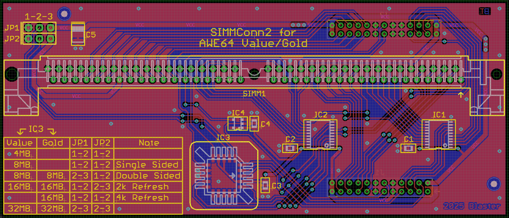
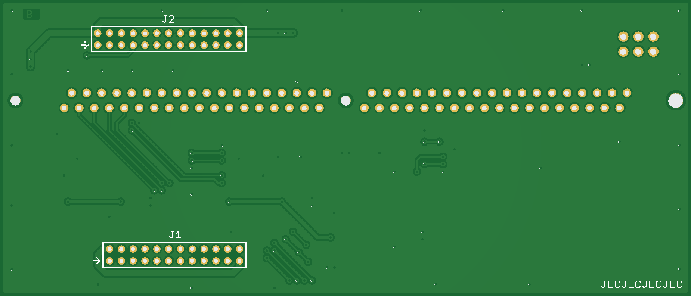

# SIMMConn2
### Memory expansion adapter for AWE64 Gold/Value

This module expands available memory on ISA soundcards from Creative Labs up to 28 MB using ordinary SIMM72 DRAM memory module.  
Based on original SIMMConn design by Xu Wang.

**List of changes compared to the original design:**
- All parts placed on top side of the PCB
- Added active driver for #WE signal
- Some data bits for SIMM rearranged for better PCB routing
- Added C5 capacitor for SIMM power supply
- JP1/JP2 settings table with complete parameters
- IC1 and IC2 in smaller TSSOP package because of limited space under SIMM module
- SIMM socket only in angled 22deg version
- Added fiducials for machine placement of components

**This project includes:**

- [Gerber files in zip for PCB manufacturing](/SIMMConn2/SIMMConn2.zip)
- [Eagle 7 CAD schematic/board files in zip](/SIMMConn2/SIMMConn2_Eagle.zip)
- [Schematic diagram in pdf](/SIMMConn2/SIMMConn2_sch.pdf)
- [Schematic of the original SIMMConn in pdf and Eagle 7 CAD format](/SIMMConn2/SIMMConn_orig.zip)

**PCB manufacturing parameters for JLCPCB:**  
- Base Material FR4  
- Layers 2  
- PCB Thickness 1.6mm  
- Material Type FR4 TG135  
- Outer Copper Weight 1 oz  
- Via Covering Tented  
- Min via hole size/diameter 0.3mm  
- Board Outline Tolerance 0.2mm(Regular)  
- Mark on PCB Order Number(Specify Position)

**BOM for specific components:**
| Ref. | Mouser part. no. | Note |
|---|---|---|
| SIMM1 | 571-5822134-3 | 72-pin SIMM 22-degree connector |
| IC1, IC2 | 595-SN74ACT245PWR | Octal bus transceivers |
| IC3 | 556-AF16V8C7JU | Programmable logic device |
| IC3 socket | 517-8420-21B1-RK-TP | PLCC20 socket|
| IC4 | 595-SN74LVC1G126DBVR | Single bus buffer gate |
| J1 | 538-79107-7011 | Molex 2x12 2mm socket header |
| J2 | 538-79107-7062 | Molex 2x13 2mm socket header |

**PCB:**

**PCB Render from JLCPCB:**

