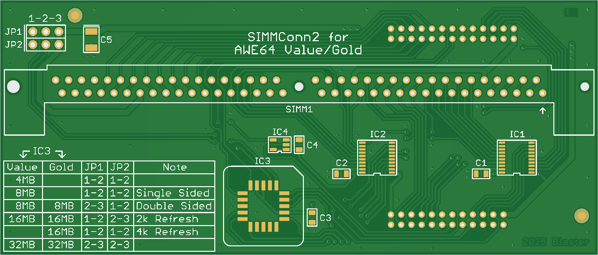

# SIMMConn2
Memory expansion adapter for AWE64 Gold/Value

This module expands available memory on ISA soundcards from Creative Labs up to 28 MB using ordinary SIMM72 DRAM memory module.  
Based on original SIMMConn design by Xu Wang.

List of changes compared to the original PCB design:
- all parts placed on top side of the PCB
- added active driver for #WE signal
- some data bits for SIMM rearranged for better PCB routing
- added C5 capacitor for SIMM power supply
- JP1/JP2 settings table with complete parameters
- IC1 and IC2 in smaller TSSOP package because of limited space under SIMM module
- SIMM socket only in angled 22deg version
- added fiducials for machine placement of components

This project includes:

- [Gerber files in zip for PCB manufacturing](/SIMMConn2/SIMMConn2.zip)
- [Eagle 7 CAD schematic/board files in zip](/SIMMConn2/SIMMConn2_Eagle.zip)
- [Schematic diagram in pdf](/SIMMConn2/SIMMConn2_sch.pdf)
- [Schematic of the original SIMMConn in pdf and Eagle 7 CAD format](/SIMMConn2/SIMMConn_orig.zip)

**PCB parameters for JLCPCB:**  
Base Material FR4  
Layers 2  
PCB Thickness 1.6mm  
Material Type FR4 TG135  
Outer Copper Weight 1 oz  
Via Covering Tented  
Min via hole size/diameter 0.3mm  
Board Outline Tolerance 0.2mm(Regular)  
Mark on PCB Order Number(Specify Position)

| Ref. | Mouser part. no. |
|---|---|
| SIMM1 | 571-5822134-3 |
| IC1,IC2 | 595-SN74ACT245PWR |
| IC3 | 556-AF16V8C7JU |
| IC3 socket | 517-8420-21B1-RK-TP |
| IC4 | 595-SN74LVC1G126DBVR |
| J1 | 538-79107-7011 |
| J2 | 538-79107-7062 |

PCB:

PCB Render from JLCPCB:

